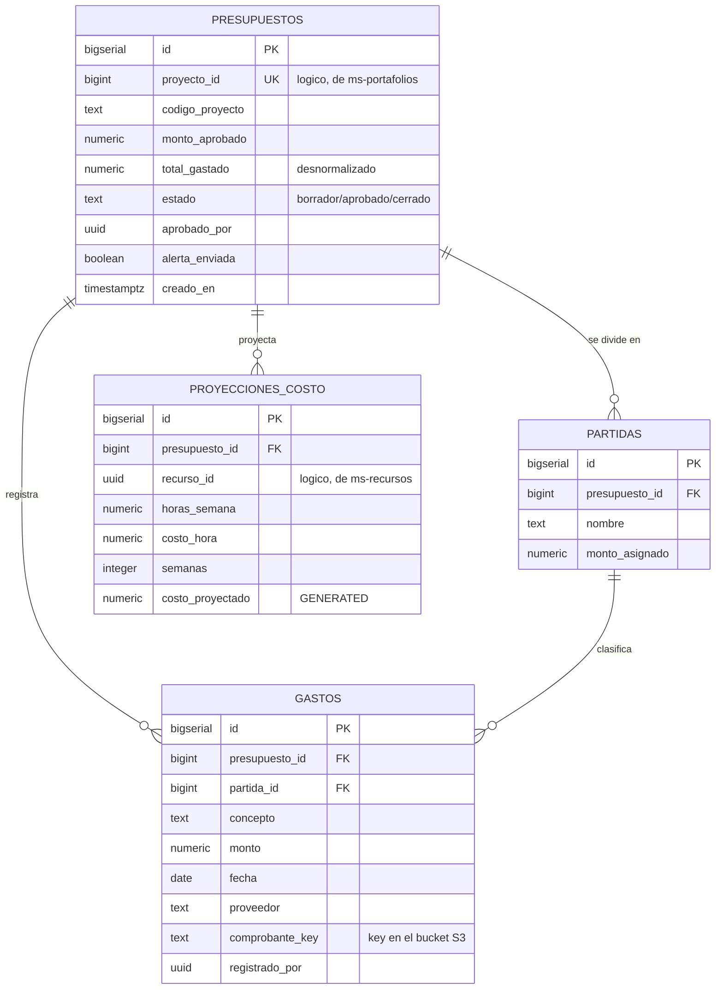

# Modelo de datos — ms-presupuestos

**Motor:** PostgreSQL en el RDS compartido · **Database:** `ppm_presupuestos`
**Schemas:** `t_acme`, `t_globex`, `t_initech` — uno por tenant
(patrón **Single Database, Multiple Schemas**)

## Diagrama entidad-relación



## La vista `ejecucion`

Responde la pregunta central del producto en una sola consulta: cuánto se
aprobó, cuánto se gastó, cuánto queda y a qué porcentaje va.

```sql
SELECT proyecto_id, monto_aprobado, total_gastado, saldo, ejecutado_pct
FROM   ejecucion WHERE ejecutado_pct >= 90;
```

## Tres decisiones de diseño

**1. `total_gastado` está desnormalizado.** Se mantiene al día sumando en cada
`INSERT` de gasto, en vez de calcular `SUM(monto)` en cada lectura. Con 7,500
gastos por tenant y el dashboard consultando constantemente, la suma en caliente
se nota. El costo es tener que mantenerlo, y el seed lo recalcula al final para
dejarlo consistente.

**2. `FOR UPDATE` al registrar un gasto.** Dos gastos simultáneos sobre el mismo
presupuesto podrían leer el mismo `total_gastado` y perder uno de los dos
incrementos. El bloqueo de fila lo evita.

**3. `alerta_enviada` es una bandera de una sola vez.** Sin ella, **cada** gasto
posterior al 90% volvería a publicar `presupuesto.excedido` y a notificar al
PMO. Con 20 gastos más después del umbral, serían 20 alertas por el mismo
proyecto.

## Lo que escribe el worker, no la API

| Tabla | Evento que la escribe | De quién |
|---|---|---|
| `presupuestos` (alta en 0) | `proyecto.creado` | ms-portafolios |
| `proyecciones_costo` | `recurso.asignado` | ms-recursos |

**El presupuesto no se crea por HTTP.** Nace cuando `ms-portafolios` publica
que hay un proyecto nuevo. Después el PMO lo aprueba con
`POST /presupuestos/{id}/aprobar`. Este microservicio no conoce a los otros dos.

## Los eventos que publica

| Evento | Cuándo | Efecto |
|---|---|---|
| `gasto.registrado` | en cada gasto | ms-analitico lo lleva al data lake |
| `presupuesto.excedido` | la **primera** vez que la ejecución cruza el 90% | ms-portafolios marca el proyecto `en_riesgo` y lo pone en rojo; la cola de alertas notifica al PMO |

El umbral es la variable de entorno `UMBRAL_ALERTA_PCT` (90 por defecto).

## Referencias lógicas

`proyecto_id` apunta a `ms-portafolios` y `recurso_id` a `ms-recursos`, **sin FK
ni validación HTTP**: los microservicios son autónomos. Si un evento de recurso
llega antes que su `proyecto.creado`, el worker lo descarta y el reintento de
SQS lo resuelve.

## Volumen de datos

| Tabla | Por tenant | Total |
|---|---|---|
| `presupuestos` | 500 | 1,500 |
| `partidas` | 1,500 | 4,500 |
| `gastos` | 7,500 | 22,500 |
| `proyecciones_costo` | 500 | 1,500 |
| **Total** | **10,000** | **30,000** |

Los gastos se reparten de forma **desigual a propósito**: unos proyectos quedan
al 20% de ejecución y otros pasan del 100%, para que el dashboard tenga
semáforos de los tres colores y casos de alerta reales en la demo.

Las partidas cambian por rubro: Acme usa Materiales / Mano de obra / Equipos;
Globex usa Consultores / Viajes / Licencias; Initech usa Desarrollo /
Infraestructura / Herramientas.

## Cargar los datos

```bash
export DB_HOST=... DB_USER=ppm_presupuestos DB_PASSWORD=... DB_NAME=ppm_presupuestos
python seed/generar.py --esquema
python seed/generar.py
python seed/generar.py --contar
```
